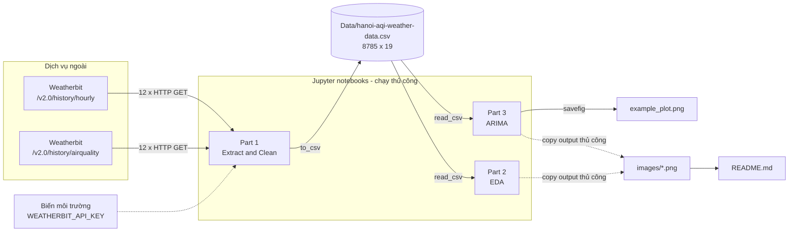
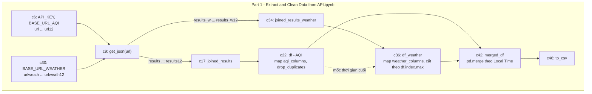
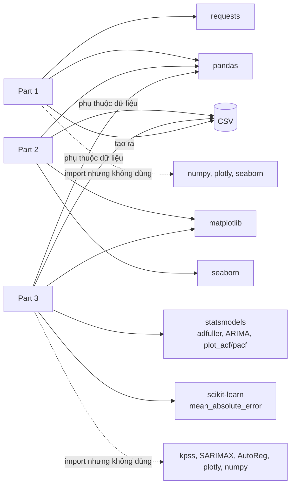
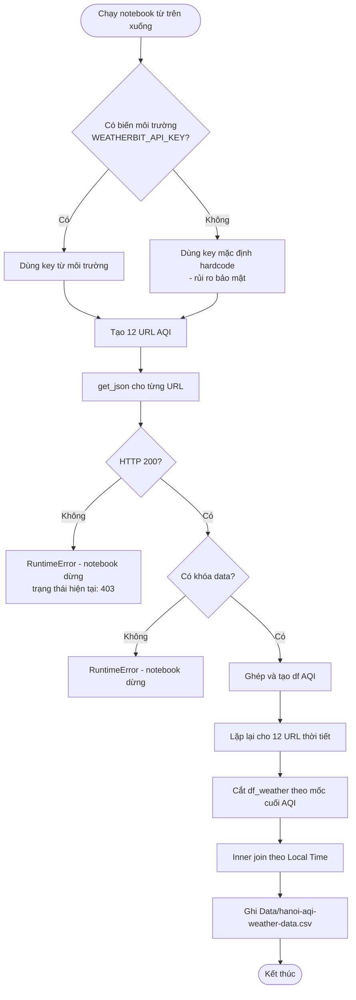
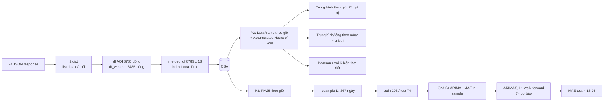
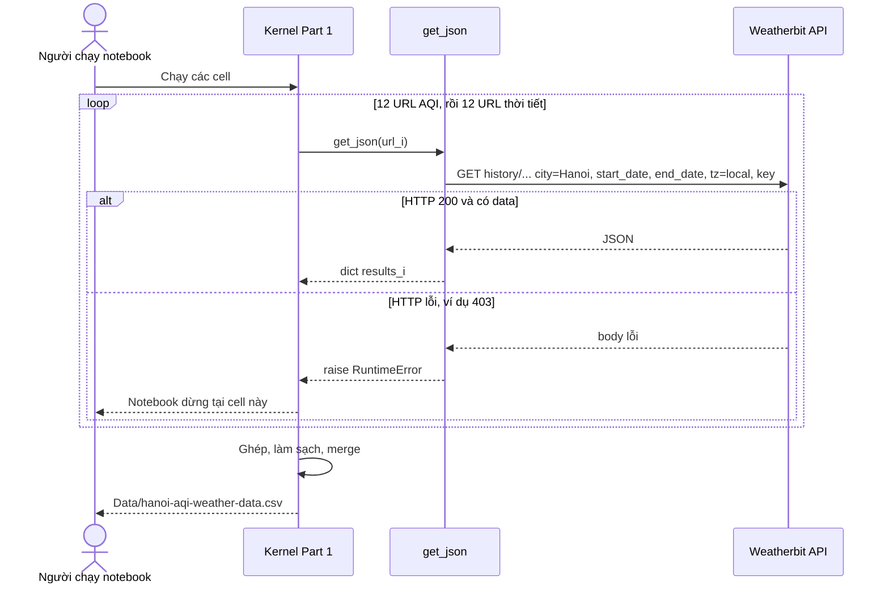
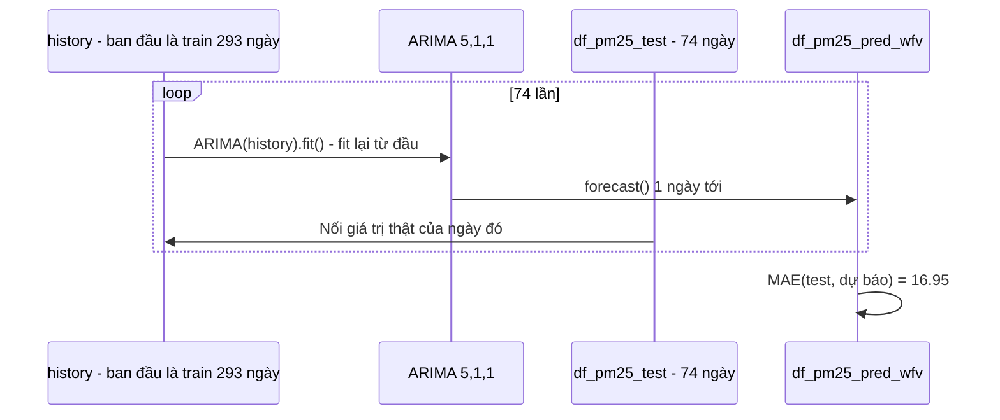

# PROJECT OVERVIEW — Hanoi_Air_Analysis

> Tài liệu phân tích dự án, viết dựa trên việc đọc toàn bộ mã nguồn, output đã lưu trong notebook, file dữ liệu và lịch sử git (commit `4822805`, cùng với thay đổi chưa commit trong Part 1).
> Ngày phân tích: 12/11/2026.

**Quy ước dẫn chứng**

| Ký hiệu | Ý nghĩa |
|---|---|
| `P1`, `P2`, `P3` | [Part 1 – Extract and Clean Data from API.ipynb](Part%201%20-%20Extract%20and%20Clean%20Data%20from%20API.ipynb), [Part 2 – Exploratory Data Analysis.ipynb](Part%202%20-%20Exploratory%20Data%20Analysis.ipynb), [Part 3 – PM2.5 Time Series Analysis with ARIMA Model.ipynb](Part%203%20-%20PM2.5%20Time%20Series%20Analysis%20with%20ARIMA%20Model.ipynb) |
| `c22` | Cell thứ 22 trong notebook, đánh số từ 0 theo thứ tự hiển thị |
| `L305` | Số dòng trong file `.ipynb` khi mở dưới dạng text (JSON). Trong VS Code: *Reopen Editor With… → Text Editor* |
| `README L64` | Dòng 64 của [README.md](README.md) |
| **[Fact]** | Điều quan sát trực tiếp trong repo |
| **[Phân tích]** | Nhận định kỹ thuật rút ra từ fact, kèm lý do |
| **[Khuyến nghị]** | Đề xuất. Không có thay đổi nào được thực hiện trong repo |

Không có API key hay thông tin bí mật nào được chép vào tài liệu này.

---

## 1. Executive Summary

**Hanoi_Air_Analysis** là một dự án **phân tích dữ liệu** (data analysis/data science) viết bằng Python, gồm ba Jupyter notebook chạy tuần tự. Dự án tìm hiểu mức độ ô nhiễm không khí ở Hà Nội trong một năm (00:00 08/03/2023 → 00:00 08/03/2024) và thử dự báo nồng độ bụi mịn PM2.5. Đây **không phải một ứng dụng hay dịch vụ**: không có server, giao diện, database hay quy trình triển khai. Về bản chất, "hệ thống" là một pipeline phân tích theo lô, và các bước chỉ giao tiếp với nhau qua **một file CSV**.

- **Part 1** gọi Weatherbit API 24 lần (12 tháng × 2 endpoint: chất lượng không khí và thời tiết). Sau đó notebook ghép, làm sạch, gộp dữ liệu theo mốc giờ địa phương và ghi ra `Data/hanoi-aqi-weather-data.csv`. File này có 8.785 dòng × 19 cột, liên tục từng giờ, không thiếu giá trị (đã kiểm tra lại).
- **Part 2** làm EDA: vẽ chuỗi thời gian AQI/PM2.5, tính trung bình PM2.5 theo giờ trong ngày và theo mùa, và tính hệ số tương quan Pearson giữa PM2.5 với 6 biến thời tiết. Một trong 6 biến là biến tự tạo: số giờ mưa liên tục.
- **Part 3** lấy trung bình PM2.5 theo ngày (367 điểm), chọn ARIMA(5,1,1) bằng grid search trên 24 mô hình, rồi đánh giá bằng walk-forward validation trên 74 ngày cuối. Kết quả MAE là **16,95 µg/m³**.

**Kết quả chính** (đã tính lại trực tiếp từ CSV, khớp với README): AQI trung bình 117,6; PM2.5 trung bình 49,4 µg/m³. Trong ngày, PM2.5 cao nhất lúc 8–9h và 19–21h. Mùa đông (83,9 µg/m³) ô nhiễm gần gấp 3 lần mùa hạ (30,8). Với PM2.5, áp suất tương quan dương (+0,30), còn nhiệt độ tương quan âm (−0,25).

**Tình trạng:** Part 2 và Part 3 đã chạy trọn vẹn và output được lưu trong notebook. Part 1 có code đầy đủ nhưng **trong phiên bản hiện tại chưa chạy thành công**: cell gọi API lưu lỗi HTTP 403, và mọi cell sau đó chưa từng được chạy. Vì vậy, file CSV có sẵn đến từ một lần chạy trước đó. Repo không có test, CI hay phiên bản thư viện cố định.

**Ba vấn đề quan trọng nhất:**

1. **Bảo mật:** Part 1 hardcode một API key Weatherbit làm giá trị mặc định. Key này nằm trong commit `4822805`, và commit đó đã có trên `origin/main`.
2. **Đánh giá mô hình bị thổi phồng:** baseline 23,13 được tính trên tập train. Trên tập test, baseline trung bình đạt 27,21, còn baseline "ngày mai bằng hôm nay" (persistence) đạt **17,48**. Như vậy ARIMA chỉ tốt hơn persistence khoảng **3%**, và biểu đồ cho thấy dự báo trễ khoảng 1 ngày. README đã thừa nhận điểm yếu này, nhưng phần kết luận trong notebook Part 3 vẫn viết rằng hai đường "gần như trùng khớp".
3. **Diễn giải tương quan:** mọi hệ số đều yếu (|r| ≤ 0,30) và bị nhiễu bởi yếu tố mùa. Kết luận trong Part 2 được phát biểu như quan hệ nhân quả, trong khi README thận trọng hơn.

Ngoài ra còn hai lỗi nhỏ hơn: biểu đồ tô màu mùa trong Part 2 bị sai (vùng "Spring" phủ gần cả năm), và đơn vị của CO gần như chắc chắn bị ghi sai.

---

## 2. Project Introduction

### 2.1. Dự án là gì?
**[Fact]** Một bộ ba notebook phân tích chất lượng không khí và thời tiết theo giờ của Hà Nội ([README L1–12](README.md)). Dự án được phát triển lại từ repo gốc *Hanoi-Air-Quality-Analysis* của Nam Aaron Nguyen. Các thay đổi được README liệt kê gồm: Việt hóa, xử lý lỗi API, sửa lỗi code, bổ sung phần đánh giá và hạn chế (README L153).

### 2.2. Vấn đề cần giải quyết
**[Fact]** README L7–10 nêu 4 câu hỏi nghiên cứu:
1. Giờ nào trong ngày PM2.5 cao nhất?
2. Mùa nào chất lượng không khí tệ nhất?
3. Các yếu tố thời tiết (mưa, áp suất, độ ẩm, nhiệt độ, gió) liên quan thế nào tới PM2.5?
4. Có thể dự báo PM2.5 theo ngày bằng ARIMA không?

### 2.3. Mục tiêu
Trả lời 4 câu hỏi trên bằng dữ liệu, trực quan hóa kết quả và đưa khuyến nghị cho người dân (README §8, P2 c98).

### 2.4. Phạm vi
| Chiều | Phạm vi | Bằng chứng |
|---|---|---|
| Không gian | Một truy vấn cấp thành phố `city=Hanoi`. Tọa độ trả về bị bỏ đi, không lưu vào CSV | P1 c6 L75, c22 (`drop(columns=['Data','Lat','Lon'])`) |
| Thời gian | 00:00 08/03/2023 → 00:00 08/03/2024, theo giờ, giờ địa phương (UTC+7) | CSV đã kiểm tra: 8.785 mốc, bước đều 1 giờ |
| Biến | 7 chỉ số chất lượng không khí và 7 biến thời tiết | P1 c22, c36 |
| Mô hình | Chỉ dùng ARIMA đơn biến trên PM2.5 trung bình ngày | P3 |

### 2.5. Đối tượng sử dụng
**Chưa đủ thông tin để kết luận.** Repo không nêu rõ đối tượng người dùng.
- **[Phân tích]** README §8 có phần "Khuyến nghị cho người dân", nên người đọc README có thể là công chúng.
- **[Phân tích]** Văn phong notebook viết ở ngôi thứ nhất và mang tính trình bày, kết hợp với việc phát triển lại từ một repo gốc, gợi ý đây là dự án học tập hoặc portfolio. Đây là suy luận, không có tài liệu xác nhận.

---

## 3. Technology Stack

Chỉ liệt kê những gì có bằng chứng trong repo.

| Công nghệ | Vai trò | Bằng chứng | Mức sử dụng thực tế |
|---|---|---|---|
| **Python** | Ngôn ngữ duy nhất | Metadata kernel của cả 3 notebook (`language_info.version = 3.13.7`) | Toàn bộ |
| **Jupyter / ipykernel** | Môi trường chạy | `requirements.txt` L9; định dạng `.ipynb` nbformat 4.5 | Toàn bộ |
| **requests** | Gọi HTTP GET tới Weatherbit | P1 c9 L136 `requests.get(url, timeout=60)` | Chỉ P1 |
| **json, os, time** (stdlib) | Parse JSON, đọc biến môi trường và tạo thư mục, đo thời gian train | P1 c9, c6, c46; P3 c39 | Có dùng |
| **pandas** | DataFrame, merge, resample, groupby, đọc/ghi CSV | P1 c22/c42/c46; P2 c10/c31; P3 c6 | Lõi |
| **matplotlib** | Vẽ toàn bộ biểu đồ | P2, P3 | Lõi |
| **seaborn** | Heatmap tương quan, scatter và regplot | P2 c68, c77–c92 | Chỉ P2 (P1 và P3 import nhưng không dùng) |
| **statsmodels** | `adfuller`, `plot_acf/pacf`, `ARIMA` | P3 c2, c12, c18, c39, c49 | Lõi của P3. `kpss`, `SARIMAX`, `AutoReg` được import nhưng **không dùng** |
| **scikit-learn** | `mean_absolute_error` | P3 c2, c32, c39, c52 | Chỉ một hàm |
| **numpy** | — | Import ở cả 3 notebook | **Không dùng trực tiếp** |
| **plotly.express** | — | Import ở cả 3 notebook | **Không dùng** |
| **Weatherbit API v2.0** | Nguồn dữ liệu (`history/airquality`, `history/hourly`) | P1 c6, c30 | Dịch vụ ngoài duy nhất |
| **CSV** | Lưu trữ trung gian và là "giao diện" giữa các notebook | `Data/hanoi-aqi-weather-data.csv` | Lõi |
| **git / GitHub** | Quản lý mã nguồn | remote `origin` trỏ tới GitHub | — |
| **venv** | Môi trường ảo tên `BDT` | README L48–50, `.gitignore` L2 | Venv không nằm trong repo |

**Không có:** database, framework web, Docker, CI/CD, framework test, công cụ lint hay format, thư viện orchestration (Airflow…), `python-dotenv`.

**[Fact]** `requirements.txt` liệt kê 9 gói **không cố định phiên bản**. Output đã lưu trong P3 trỏ tới một venv ở đường dẫn khác (`…/Big_Data/BDT/lib/python3.13/…`), và venv đó hiện không còn trên máy. Metadata kernel ghi tên `BDT (3.14.0)` nhưng `language_info` lại ghi `3.13.7`.
**[Phân tích]** Không thể biết chính xác phiên bản thư viện đã tạo ra output. statsmodels đã cảnh báo thay đổi API của `adfuller` (P3 c12, stderr), nên chạy lại với phiên bản mới có thể ra kết quả hoặc cảnh báo khác.

---

## 4. Repository Structure

```
Hanoi_Air_Analysis/                              (19 file được git theo dõi, 1 commit)
├── Part 1 - Extract and Clean Data from API.ipynb             28 KB   48 cell (20 code)  ← đang có thay đổi chưa commit
├── Part 2 - Exploratory Data Analysis.ipynb                   2.4 MB  99 cell (27 code)  ← nặng vì chứa ảnh output và ảnh đính kèm
├── Part 3 - PM2.5 Time Series Analysis with ARIMA Model.ipynb 552 KB  57 cell (20 code)
├── Data/
│   └── hanoi-aqi-weather-data.csv               1.1 MB  8.785 dòng × 19 cột
├── images/                                      11 PNG dùng trong README
├── example_plot.png                             do P3 c44 ghi ra (residual diagnostics)
├── README.md                                    tài liệu chính, tiếng Việt
├── requirements.txt                             9 dependency không cố định phiên bản
├── .gitignore                                   BDT/, __pycache__, .ipynb_checkpoints, .env, .vscode/
└── .vscode/extensions.json                      bị ignore, không được theo dõi
```

| File | Vai trò | Ghi chú |
|---|---|---|
| P1 | Entry point của bước thu thập dữ liệu | Cần API key Weatherbit gói trả phí (README L54) |
| P2 | Entry point của bước EDA | Chạy độc lập được, chỉ cần CSV |
| P3 | Entry point của bước mô hình hóa | Chạy độc lập được, chỉ cần CSV |
| CSV | "Hợp đồng dữ liệu" giữa P1 và P2/P3 | Tên cột đúng như P1 c42 tạo ra |
| `images/*.png` | Hình minh họa cho README | **[Fact]** Cả 11 file trùng khớp từng byte với output của P2 c20, c31, c34, c68, c77, c80, c83, c86, c89, c92 và P3 c55. Không có dòng code nào ghi vào `images/`, nên ảnh được xuất thủ công từ output notebook |
| `example_plot.png` | Biểu đồ chẩn đoán phần dư | P3 c44 L1191 `plt.savefig('example_plot.png')`. README không dùng |

**Thay đổi chưa commit** (`git diff --stat`: 1 dòng thêm, 8 dòng xóa): ở cell tiêu đề P1 c0, dòng "Tác giả: Nam Aaron Nguyen" và một ảnh JPEG đính kèm (base64) đã bị xóa. P2 c0 và P3 c0 vẫn giữ dòng tác giả và ảnh đính kèm.

---

## 5. System Architecture

### 5.1. Kiểu kiến trúc
**[Phân tích]** Đây là một **pipeline phân tích theo lô, gồm các bước notebook nối với nhau qua file** (staged notebook pipeline). Có thể hình dung như ETL thủ công rồi đến phân tích:

| Tầng | Thành phần | Trách nhiệm |
|---|---|---|
| Nguồn | Weatherbit API (2 endpoint) | Cung cấp JSON lịch sử theo giờ |
| Thu thập và làm sạch (E + T) | P1 | Gọi API, ghép, chuẩn hóa, gộp |
| Lưu trữ (L) | `Data/hanoi-aqi-weather-data.csv` | Dataset đã làm sạch, đóng vai trò giao diện duy nhất giữa các bước |
| Phân tích | P2 | Thống kê mô tả, gom nhóm, tương quan, biểu đồ |
| Mô hình hóa | P3 | Chuỗi ngày, kiểm định tính dừng, ARIMA, đánh giá |
| Trình bày | README + `images/` | Tổng hợp kết quả. Ảnh được copy thủ công |

### 5.2. Cơ chế giao tiếp thực sự tồn tại

| Cơ chế | Có? | Chi tiết |
|---|---|---|
| Giao tiếp HTTP với dịch vụ ngoài | Có | P1 → Weatherbit, HTTP GET đồng bộ, tuần tự, 24 request |
| Trao đổi qua file | Có | P1 ghi CSV (c46 L630); P2 (c10 L489) và P3 (c4 L433) đọc CSV bằng **đường dẫn tương đối** `Data/...` |
| Shared state | Có, **chỉ trong từng kernel** | Các cell dùng chung biến global (`df`, `results`…), nên thứ tự chạy cell quyết định kết quả |
| Function call | Rất ít | Hàm tự định nghĩa duy nhất là `get_json(url)` (P1 c9 L134). Phần còn lại là code tuyến tính |
| Import giữa các module | **Không** | Không có file `.py`, notebook không import lẫn nhau |
| Event, message, queue | Không | — |
| Database | Không | — |
| Điều phối (orchestrator) | Không | Người dùng tự mở và chạy từng notebook theo thứ tự P1 → P2 hoặc P3 |

### 5.3. Architecture/design pattern
**[Phân tích]** Không có bằng chứng cho MVC, Layered (theo nghĩa code), Clean, Hexagonal, Repository, Dependency Injection hay Event-Driven. Không nên gán các pattern này cho dự án. Những gì có thể khẳng định:
- **Batch pipeline có file làm điểm bàn giao** giữa các bước.
- **Chia nhỏ yêu cầu theo khoảng thời gian (chunked fetching)**: tách một năm thành 12 cửa sổ tháng vì giới hạn của API (P1 c7), sau đó ghép lại và loại trùng.
- **Ánh xạ schema khai báo (declarative column mapping)**: dùng dict `aqi_columns` và `weather_columns` để chọn và đổi tên trường theo khóa JSON (P1 c22, c36). Cách này giúp code không phụ thuộc vào thứ tự trường mà API trả về.

---

## 6. Core Modules

Ở đây "module" được hiểu là notebook hoặc artifact, vì repo không có package Python nào.

| Module | Vị trí | Trách nhiệm | Input | Output | Phụ thuộc |
|---|---|---|---|---|---|
| **M1 – Ingestion & Cleaning** | P1 | Gọi API, ghép, làm sạch, gộp, xuất CSV | `WEATHERBIT_API_KEY`, 2 endpoint Weatherbit | CSV 8.785 × 19 | requests, pandas, os, json |
| **M2 – Dataset** | `Data/…csv` | Lưu dữ liệu đã làm sạch | Do M1 ghi | Được M3 và M4 đọc | — |
| **M3 – EDA** | P2 | Mô tả, phân tích theo giờ và mùa, tương quan với thời tiết | CSV | Biểu đồ inline, số liệu in ra, kết luận dạng markdown | pandas, matplotlib, seaborn |
| **M4 – Forecasting** | P3 | Chuỗi ngày, ADF, ACF/PACF, grid search ARIMA, walk-forward | CSV | MAE, biểu đồ, `example_plot.png` | pandas, statsmodels, scikit-learn, matplotlib |
| **M5 – Documentation** | README, `images/` | Tổng hợp kết quả, cách chạy, hạn chế | Output của M3 và M4 (copy thủ công) | Tài liệu cho người đọc | — |
| **M6 – Environment/Config** | `requirements.txt`, `.gitignore`, biến môi trường | Cài đặt và cấu hình | — | — | pip, venv |

### 6.1. M1 – Part 1: Extract and Clean Data from API

| Cell | Dòng | Việc làm |
|---|---|---|
| c2 | L27 | Import (`os, requests, json, pandas, numpy, matplotlib, datetime, seaborn, plotly`). Trong số này chỉ `os, requests, json, pandas` được dùng |
| c6 | L75–78 | `API_KEY = os.getenv("WEATHERBIT_API_KEY", <key hardcode>)`, `BASE_URL_AQI`, và **12 biến URL** `url…url12`. Mỗi URL là một cửa sổ "ngày 08 tháng này → ngày 08 tháng sau" với `city=Hanoi&tz=local` |
| c7 | L102 | Giải thích lý do chia cửa sổ: API trả tối đa 800 điểm mỗi lần gọi |
| c9 | L133–145 | `get_json(url)`: GET với timeout 60 giây. Nếu `status_code != 200` thì `raise RuntimeError` kèm body. Nếu JSON thiếu khóa `'data'` thì cũng `RuntimeError`. Hàm được gọi **tuần tự 12 lần** để tạo `results…results12` |
| c11–c14 | L189–220 | Xem cấu trúc JSON (`city_name`, `country_code`, `data[0]`, `data[-1]`) |
| c17 | L247 | Nối 12 list `data` bằng `+` và tạo dict `joined_results`. Metadata lấy từ response đầu tiên |
| c22 | L305–336 | Tạo DataFrame từ dict (metadata được lặp lại cho mọi dòng), tách cột `Data` theo `aqi_columns` (9 khóa), bỏ `Data/Lat/Lon`, `drop_duplicates()` (L321), sắp xếp, chuyển `Local Time` sang datetime và đặt làm index |
| c30–c36 | L399–535 | Lặp lại quy trình với `history/hourly`. Cửa sổ đầu kết thúc ở 09/03/2024, sau đó cắt bằng `.loc[:df.index.max()]` (L529) để khớp với mốc cuối của dữ liệu AQI |
| c42 | L582–597 | `pd.merge(df, df_weather, left_index=True, right_index=True)` (inner join theo `Local Time`), bỏ các cột `_y` bị trùng, đưa `UTC Time` lên đầu, đổi tên cột |
| c46 | L627–630 | `os.makedirs('Data', exist_ok=True)` rồi `merged_df.to_csv('Data/hanoi-aqi-weather-data.csv')` |

**[Fact]** Trong file hiện tại, c2/c6/c9 có `execution_count` 5/6/7. **c9 lưu output lỗi** `RuntimeError: Weatherbit API trả về lỗi HTTP 403: … Your API Key does not allow access to this endpoint…`. **Mọi code cell từ c11 đến c46 đều có `execution_count = None`**, tức là chưa từng chạy trong phiên bản này.
**[Phân tích]** CSV đang có trong repo không được tạo ra bởi lần chạy được lưu trong notebook hiện tại. Tuy vậy, schema CSV (19 cột, thứ tự cột, tên cột) khớp chính xác với những gì c42 tạo ra, nên nhiều khả năng CSV được sinh bởi cùng logic này ở một lần chạy trước. Ai chạy và khi nào thì **chưa đủ thông tin để kết luận**.

### 6.2. M3 – Part 2: Exploratory Data Analysis

| Nhóm | Cell (dòng) | Nội dung | Kết quả đã lưu |
|---|---|---|---|
| Nạp dữ liệu | c10 (L489) | `read_csv`, đặt `Local Time` làm index | 8.785 dòng |
| Thống kê mô tả | c16 (L772) | `df.describe()` | AQI trung bình 117,63; PM25 trung bình 49,40 |
| AQI | c20 (L824), c23 (L886) | Chuỗi theo giờ cả năm với các đường ngưỡng; tháng 11, 12 và 2 | Đỉnh AQI = 500 lúc 19:00 07/02/2024 |
| PM2.5 theo giờ | c28 (L973), c31 (L1039) | `groupby(df.index.hour).mean()`, top 5 | 8h: 54,40; 9h: 54,09; 19h: 55,19; 20h: **57,75**; 21h: 54,89 |
| PM2.5 theo mùa | c34 (L1108) | Dict `seasons` (Xuân T2–4, Hạ T5–7, Thu T8–10, Đông T11–1) | Đông 83,86 · Xuân 45,59 · Thu 37,27 · Hạ 30,81 |
| Thời tiết theo mùa | c38–c65 | Mưa (tổng), áp suất, độ ẩm, nhiệt độ, gió (trung bình) | Mưa 2.408,25 mm/năm; độ ẩm 78,04%; nhiệt độ 25,28 °C; gió 1,61 m/s |
| Tương quan giữa các chất ô nhiễm | c68 (L1879) | Heatmap của AQI, CO, NO2, O3, PM10, PM25, SO2 | PM2.5 và PM10 tương quan cao với AQI |
| Feature engineering | c73 (L2161) | `Accumulated Hours of Rain`: vòng lặp `for`, cộng 1 nếu `Precipitation > 0`, ngược lại đặt về 0 | Max 67 giờ |
| PM2.5 với thời tiết | c77, c80, c83, c86, c89, c92 | Scatter, `regplot` và Pearson `corr` | Số giờ mưa −0,12 · lượng mưa −0,09 · áp suất **+0,30** · độ ẩm −0,01 · nhiệt độ −0,25 · gió −0,16 |
| Kết luận | c96 (L2632), c98 (L2666) | Tổng hợp và khuyến nghị sức khỏe | — |

**[Fact]** `execution_count` chạy liên tục từ 1 đến 27, nên notebook đã được chạy trọn vẹn một lượt theo đúng thứ tự.
**[Fact]** Các cột `Clouds`, `UV Index`, `CO`, `NO2`, `O3`, `SO2` chỉ xuất hiện trong `describe()` và heatmap, không được phân tích sâu.

### 6.3. M4 – Part 3: ARIMA Forecasting

| Bước | Cell (dòng) | Nội dung | Kết quả |
|---|---|---|---|
| Chuỗi ngày | c6 (L486–488) | `resample('D')['PM25'].agg('mean')` | 367 điểm, `freq=D` |
| ADF trên toàn chuỗi | c12 (L575) | `adfuller(df_pm25)` | stat −4,11; **p = 0,0009 → có tính dừng** (c13) |
| ACF/PACF | c18 (L679), c20 (L722) | `plot_acf`, `plot_pacf` | PACF gợi ý AR(2) (c21) |
| Chia train/test | c25 (L792) | 80/20 theo thứ tự thời gian | 293 / 74. Test bắt đầu từ **26/12/2023** |
| ADF trên train | c28 (L840) | `adfuller(train)` | p = 0,0905 → không dừng ở mức 5%, nên **chọn d = 1** (c29) |
| Baseline | c32 (L889) | Dự đoán bằng trung bình train và tính MAE **trên chính train** | 23,13 |
| Grid search | c37–c41 (L956–1147) | p ∈ 0..7, q ∈ 0..2, d = 1. Tổng 24 mô hình, mỗi mô hình `fit` trên train rồi tính **MAE in-sample** bằng `model.predict()` (L1042) | Tốt nhất là (5,1,1) với 11,6377. Toàn bộ dải chỉ từ 11,64 đến 12,10 |
| Chẩn đoán phần dư | c44 (L1185) | `plot_diagnostics` và `savefig` | Đỉnh phần dư vào tháng 11–12 |
| Walk-forward | c49 (L1248–1257) | 74 vòng: `ARIMA(history,(5,1,1)).fit()` → `forecast()` 1 bước → nối giá trị thật vào `history` | 74 dự báo |
| Đánh giá | c52 (L1314) | MAE giữa test và dự báo | **16,95** |
| Trình bày | c55 (L1352), c56 | Vẽ test so với dự báo | Ảnh giống hệt `images/arima_walk_forward.png` |

---

## 7. Main Functionalities

### F1. Thu thập dữ liệu chất lượng không khí và thời tiết (P1 c6–c36)
- **Giải quyết:** lấy một năm dữ liệu theo giờ, trong khi mỗi lần gọi API chỉ được tối đa khoảng 800 điểm.
- **Kích hoạt:** người dùng chạy P1 thủ công sau khi đã `export WEATHERBIT_API_KEY` (README L56–58).
- **Quy trình:** 12 URL cho mỗi endpoint → `get_json` tuần tự → nối các list `data` → DataFrame → chọn cột theo khóa JSON → bỏ trùng → sắp xếp → đặt index datetime.
- **Input/Output:** query string (`city`, `start_date`, `end_date`, `tz=local`, `key`) → `df` (AQI) và `df_weather`, mỗi bảng 8.785 dòng.
- **Điều kiện đặc biệt:** các cửa sổ liền kề trùng nhau ở điểm ranh giới ngày 08 và được xử lý bằng `drop_duplicates()` (P1 L320–321). Dữ liệu thời tiết được lấy dư đến 09/03 rồi cắt bớt (L529).
- **Xử lý lỗi:** có timeout 60 giây; HTTP khác 200 hoặc thiếu `data` thì `RuntimeError`, khiến notebook dừng. Không có retry, backoff hay cache JSON thô.

### F2. Gộp và xuất dataset (P1 c42–c46)
- Inner join theo index `Local Time`, bỏ cột trùng, ghi CSV. **Không có bước kiểm tra** số dòng sau merge hay tính duy nhất của index (chỉ có `df.info()` để người dùng tự nhìn).
- **[Fact, đã kiểm tra]** CSV đang có: 8.785 mốc thời gian duy nhất, đã sắp xếp, bước đều 1 giờ, không có ô trống. `Local Time − UTC Time = +7h` ở mọi dòng. `City/Country/Timezone` là hằng số `Hanoi/VN/Asia/Ho_Chi_Minh`.

### F3. Thống kê tổng quan và chuỗi thời gian AQI/PM2.5 (P2 c16–c28)
- Dùng `describe()`, vẽ line plot kèm các đường ngưỡng US EPA và dùng `idxmax()` để tìm đỉnh.

### F4. Phân tích PM2.5 theo giờ trong ngày (P2 c31)
- Với mỗi giờ (0–23), lấy trung bình khoảng 366 giá trị, mỗi ngày một giá trị. Kết quả: giờ thấp nhất là 16h (40,61) và giờ cao nhất là 20h (57,75). **Không giờ nào dưới 35,5 µg/m³** (đã kiểm tra lại).

### F5. Phân tích theo mùa (P2 c34, c40, c46, c52, c59, c65)
- Dùng `df.index.month.isin(months)` cho từng mùa. **[Fact]** Mùa Xuân gồm dữ liệu của **hai năm khác nhau** (08/03–30/04/2023 và 01/02–08/03/2024) và có 2.161 giờ, so với 2.208 giờ ở các mùa còn lại.

### F6. Feature engineering "số giờ mưa liên tục" (P2 c73)
- Biến đếm chuỗi giờ liên tiếp có mưa. Biến này chỉ tồn tại trong bộ nhớ của P2 và **không được ghi lại vào CSV**.

### F7. Tương quan PM2.5 với thời tiết (P2 c77–c92)
- Mỗi biến có một scatter, một đường hồi quy tuyến tính và một hệ số Pearson. Không có p-value, khoảng tin cậy hay kiểm soát biến nhiễu.

### F8. Chuẩn bị chuỗi thời gian và kiểm định tính dừng (P3 c6–c29)
- Resample theo ngày, chạy ADF trên toàn chuỗi và trên tập train, xem ACF/PACF.

### F9. Chọn mô hình ARIMA (P3 c32–c44)
- Grid search 24 cấu hình theo MAE in-sample. `ConvergenceWarning` bị tắt (c2), còn `EstimationWarning` vẫn hiện ở (2,1,2).

### F10. Walk-forward validation (P3 c49–c56)
- Fit lại mô hình từ đầu ở mỗi bước (74 lần), dự báo 1 bước tới, sau đó nạp giá trị thật vào lịch sử.
- **[Fact]** Series dự báo có `dtype: object` (output của c50), do được khởi tạo bằng `pd.Series()` rỗng (L1249). Sklearn vẫn tính được MAE.
- **Không có** dự báo nào cho thời điểm sau 08/03/2024 và mô hình cũng không được lưu lại (không pickle).

---

## 8. Execution & Data Flow

### 8.1. Execution flow
1. **Khởi động:** tạo venv, `pip install -r requirements.txt` (README L47–51), mở notebook trong Jupyter hoặc VS Code. Thư mục làm việc **phải là gốc repo** vì đường dẫn `Data/...` là đường dẫn tương đối.
2. **P1** (tùy chọn, cần key trả phí): chạy các cell tuần tự. Gặp lỗi API ở bất kỳ request nào thì notebook dừng tại cell đó.
3. **P2** và **P3** độc lập với nhau, cùng đọc CSV. Không có điều phối: người dùng tự quyết định chạy notebook nào.
4. **Kết thúc:** P1 kết thúc khi đã ghi CSV. P2 kết thúc ở phần kết luận dạng markdown. P3 kết thúc ở biểu đồ walk-forward. Việc cập nhật README và `images/` là thủ công.

### 8.2. Data flow

| Giai đoạn | Dạng dữ liệu | Biến đổi |
|---|---|---|
| API | 24 JSON `{city_name, country_code, lat, lon, timezone, data:[…]}` | — |
| P1 c17/c34 | 2 dict, mỗi dict có list `data` đã nối | Nối list |
| P1 c22/c36 | 2 DataFrame có index `Local Time` | Chọn và đổi tên cột, bỏ trùng, chuyển kiểu datetime |
| P1 c42 | `merged_df` 8.785 × 18 (+ index) | Inner join, bỏ cột trùng |
| CSV | 19 cột text | Ghi file |
| P2 | DataFrame theo giờ + `Accumulated Hours of Rain` | groupby theo giờ/mùa, corr, plot |
| P3 | Series PM25 theo giờ → 367 điểm theo ngày → train 293 / test 74 | resample, chia tập, fit, forecast |
| Output | Biểu đồ inline, số liệu in ra, `example_plot.png`; copy thủ công sang `images/` | — |

### 8.3. Error handling (chỉ những gì có trong code)

| Cơ chế | Có? | Vị trí |
|---|---|---|
| Phát hiện lỗi HTTP | Có | P1 L138: `status_code != 200` → `RuntimeError` kèm status và body |
| Kiểm tra cấu trúc response | Một phần | P1 L143: chỉ kiểm tra có khóa `'data'` |
| Timeout | Có | P1 L136: 60 giây |
| Retry / backoff | **Không** | — |
| Fallback | Có, nhưng **là anti-pattern bảo mật** | P1 L78: không có biến môi trường thì dùng key hardcode |
| Logging | Không | Chỉ dùng `print` |
| Validation dữ liệu (khoảng giá trị, schema, độ liên tục thời gian) | **Không** | Chỉ có `df.info()` để người dùng tự xem |
| Phục hồi / chạy lại một phần | Không | JSON thô không được cache, mỗi lần chạy lại phải gọi lại cả 24 request |
| Quản lý cảnh báo | Có | P3 c2 tắt `ConvergenceWarning`, có thể che mất các mô hình không hội tụ trong grid search |

---

## 9. Database & Integrations

### 9.1. Database
**[Fact]** Không có database, ORM hay migration. Lớp lưu trữ duy nhất là **một file CSV**.

**Mô hình dữ liệu của CSV** (ánh xạ lấy từ P1 c22, c36, c42):

| Cột CSV | Endpoint | Khóa JSON | Đơn vị (theo README L25–26) | Ghi chú |
|---|---|---|---|---|
| `Local Time` | cả hai | `timestamp_local` | — | Index, khóa join |
| `UTC Time` | airquality | `timestamp_utc` | — | Bản từ endpoint thời tiết bị bỏ |
| `City`, `Country Code`, `Timezone` | airquality | `city_name`, `country_code`, `timezone` | — | Metadata cấp response, lặp lại ở mọi dòng |
| `AQI` | airquality | `aqi` | Thang US EPA 0–500 | |
| `CO` | airquality | `co` | README ghi **mg/m³** | **[Phân tích]** gần như chắc chắn sai, xem §10.4 |
| `NO2`, `O3`, `PM10`, `PM25`, `SO2` | airquality | `no2`, `o3`, `pm10`, `pm25`, `so2` | µg/m³ | |
| `Clouds` | hourly | `clouds` | % | |
| `Precipitation` | hourly | `precip` | mm | |
| `Pressure` | hourly | `pres` | hPa | |
| `Relative Humidity` | hourly | `rh` | % | |
| `Temperature` | hourly | `temp` | °C | |
| `UV Index` | hourly | `uv` | — | |
| `Wind Speed` | hourly | `wind_spd` | m/s | |

### 9.2. Tích hợp bên ngoài

| Tích hợp | Cách dùng | Xác thực | Ghi chú |
|---|---|---|---|
| Weatherbit `GET /v2.0/history/airquality` | 12 request, `city=Hanoi&start_date&end_date&tz=local` | Tham số `key=` trong query string | README L54 và P1 c4 cho biết cần gói trả phí. Output P1 c9 xác nhận key đang cấu hình bị từ chối với HTTP 403 |
| Weatherbit `GET /v2.0/history/hourly` | 12 request, tham số tương tự | Như trên | |

Ngoài ra không có dịch vụ cloud, message broker hay nhà cung cấp xác thực nào. Các link trong README và markdown của P2 (IQAir, UCAR, VnExpress, US EPA…) chỉ là tài liệu tham khảo, không phải tích hợp.

**[Phân tích]** Repo không cho biết dữ liệu chất lượng không khí của Weatherbit là số đo từ trạm hay giá trị ước lượng từ mô hình. README L138 gọi đây là "1 điểm đo". Chưa đủ thông tin để kết luận đây có phải là trạm đo vật lý hay không.

---

## 10. Specialized Technical Components

Dự án thuộc lĩnh vực **Data Engineering (quy mô nhỏ)**, **phân tích thống kê** và **dự báo chuỗi thời gian**. Phần này đi sâu vào ba khía cạnh đó.

### 10.1. Data Engineering – bước thu thập
- **Chia khoảng thời gian:** 12 cửa sổ tháng được viết tay thành 24 biến URL và 24 biến kết quả. **[Phân tích]** Cách này dễ sai khi đổi khoảng thời gian, vì phải sửa 24 chỗ. Một vòng lặp sinh ra các cặp `(start, end)` sẽ thay thế được toàn bộ.
- **Loại trùng:** `drop_duplicates()` so sánh **toàn bộ dòng**, không so sánh theo timestamp. **[Phân tích]** Nếu hai lần gọi trả về giá trị hơi khác nhau cho cùng một giờ ranh giới thì sẽ còn sót timestamp trùng, và inner join sẽ nhân bản dòng. Trong lần chạy đã tạo ra CSV, điều này không xảy ra (đã kiểm tra: không có timestamp trùng), nhưng code không có bước nào đảm bảo điều đó.
- **Join:** inner join có thể âm thầm làm mất những giờ chỉ có ở một bên. CSV hiện tại đủ cả 8.785 = 366 × 24 + 1 giờ, nên không mất dòng nào.
- **Tính idempotent:** chạy lại sẽ ghi đè CSV. Không có version hay snapshot của dữ liệu thô.

### 10.2. Phân tích thống kê (P2) – đánh giá phương pháp
- **Pearson trên dữ liệu theo giờ:** 8.785 điểm có tự tương quan mạnh, nên số quan sát "hiệu dụng" nhỏ hơn nhiều. Nếu có tính p-value thì kết quả sẽ lạc quan quá mức. Notebook không tính p-value.
- **Nhiễu do mùa (seasonal confounding):** mùa đông vừa lạnh, vừa áp suất cao, vừa ít mưa (P2 c46, c59, c40). Vì vậy tương quan +0,30 của áp suất và −0,25 của nhiệt độ phần lớn có thể là **hiệu ứng mùa**. README L117 đã nêu điều này, nhưng kết luận trong P2 c96 viết "Áp suất khí quyển càng cao thì nồng độ PM2.5 càng cao", "Mưa càng to thì nồng độ PM2.5 càng thấp" như những quy luật chắc chắn, dù r chỉ là −0,09.
- **Giờ cao điểm:** việc gán đỉnh 8–9h và 19–21h cho giao thông (P2 c32) là một giả thuyết hợp lý. Tuy nhiên, độ cao lớp biên khí quyển thay đổi trong ngày cũng tạo ra quy luật tương tự. Dữ liệu trong repo không đủ để tách hai nguyên nhân này.

### 10.3. Dự báo chuỗi thời gian (P3) – đánh giá mô hình
Các số dưới đây tôi tự tính lại bằng Python thuần trên CSV, dùng đúng cách chia 80/20 của P3:

| Mô hình | Tập đánh giá | MAE (µg/m³) | Nguồn |
|---|---|---|---|
| Baseline trung bình train | **Train** (in-sample) | 23,13 | P3 c32, README L129 |
| Baseline trung bình train | **Test** | **27,21** | Tính lại |
| Persistence (giá trị ngày mai = hôm nay) | **Test** | **17,48** | Tính lại |
| ARIMA(5,1,1) walk-forward | Test | 16,95 | P3 c52 |

**[Phân tích]**
- So với một baseline công bằng (persistence), ARIMA(5,1,1) chỉ cải thiện khoảng **3%**. Mức này phù hợp với biểu đồ ([images/arima_walk_forward.png](images/arima_walk_forward.png)), trong đó đường dự báo gần như là đường thực tế dịch sang phải 1 ngày.
- **Chọn mô hình bằng MAE in-sample** (L1042) luôn có xu hướng ưu tiên mô hình phức tạp hơn. Chênh lệch giữa 24 mô hình chỉ khoảng 4% (11,64–12,10), nên việc "chọn (5,1,1)" gần như không có ý nghĩa thống kê. AIC/BIC hoặc một tập validation tách riêng sẽ đáng tin hơn.
- **Chọn d:** ADF trên toàn chuỗi cho thấy chuỗi có tính dừng (p = 0,0009), còn trên tập train thì p = 0,09, tức là vẫn dừng ở mức 10%. Notebook chọn d = 1 nhưng không so sánh với d = 0.
- **Lệch phân phối giữa train và test:** tập test (26/12/2023 → 08/03/2024) rơi gọn vào mùa ô nhiễm nhất và biến động mạnh nhất, trong khi tập train phần lớn là từ tháng 3 đến tháng 12. Đây cũng là lý do baseline trung bình train kém hẳn trên tập test.
- **Ngày cuối không đầy đủ:** điểm cuối 08/03/2024 chỉ được tính từ **1** giá trị giờ (00:00) nhưng vẫn được đưa vào test như một "ngày".
- **Nhãn biểu đồ sai:** trục x của ACF/PACF ghi `Lag [hours]` (L682, L725) trong khi chuỗi là theo ngày.

### 10.4. Chất lượng dữ liệu
- **Đơn vị CO:** README L25 và P2 c6 ghi `mg/m³`. Trung bình 436 mg/m³ tương đương khoảng 380 ppm, mức gây ngộ độc cấp và không thể là trung bình năm ngoài trời ở đô thị. **[Phân tích]** Nhiều khả năng đơn vị thực tế là **µg/m³**, cần đối chiếu với tài liệu Weatherbit.
- **CO có những giá trị cực đại bất thường** (max 15.956; ví dụ 6.738,4 lúc 20:00 07/03/2024 trong output của P2 c10). Chưa có bước kiểm tra outlier.
- **Tự kiểm tra README:** mọi con số định lượng trong README §2, §6.1–6.5 đều khớp với CSV, gồm: 3,6% số giờ AQI ≤ 50; 25,7% số giờ AQI > 150; tương quan AQI–PM2.5 0,876 và AQI–PM10 0,883; PM2.5 thấp nhất 40,6 lúc 16h; trung bình theo mùa; baseline 23,13.

---

## 11. Testing & Security

### 11.1. Testing
| Hạng mục | Tình trạng |
|---|---|
| Unit / integration / E2E test | **Không có** (không có file test hay framework test nào) |
| CI | Không có |
| Assertion trong notebook | Không có. Việc kiểm tra dựa vào `df.info()` và mắt người |
| Kiểm chứng tái lập | P2 và P3 có output đầy đủ. P1 không tái lập được trong trạng thái hiện tại (lỗi 403) |

Các chức năng nên được kiểm thử nhất: loại trùng và kiểm tra độ liên tục thời gian sau merge (P1), số giờ mưa liên tục (P2 c73), cách chia train/test và vòng walk-forward (P3).

### 11.2. Security

| Vấn đề | Mức độ | Bằng chứng | Khuyến nghị |
|---|---|---|---|
| **API key hardcode làm giá trị mặc định** | **Cao** | P1 c6 L78. Key nằm trong commit `4822805`, và `HEAD` trùng với `origin/main` nên đã được push lên GitHub. Response 403 có nội dung *"does not allow access to this endpoint"*, cho thấy key được Weatherbit nhận diện là hợp lệ nhưng không có quyền truy cập dữ liệu lịch sử | (1) Thu hồi hoặc đổi key trên Weatherbit. (2) Bỏ giá trị mặc định: báo lỗi rõ ràng nếu thiếu `WEATHERBIT_API_KEY`. (3) Nếu repo public, cân nhắc xóa key khỏi lịch sử git (`git filter-repo`/BFG). Lưu ý: việc này viết lại lịch sử, nên chỉ làm khi đã cân nhắc kỹ |
| Key nằm trong URL query | Trung bình | P1 c6, c30 | Một số exception của `requests`, ví dụ lỗi kết nối, in URL đầy đủ trong traceback. Traceback đó sẽ được lưu vào output notebook và có thể bị commit. Nên xóa output trước khi commit (vd. `nbstripout`) |
| `.env` có trong `.gitignore` nhưng không được nạp | Thấp | `.gitignore` L10; không dùng `python-dotenv` | Hoặc nạp `.env`, hoặc ghi rõ trong README rằng chỉ hỗ trợ `export` |
| Authentication / authorization | Không áp dụng | Không có dịch vụ hay người dùng | — |
| Kiểm tra input | Thấp | Chỉ kiểm tra HTTP status và khóa `data` | Thêm kiểm tra schema và khoảng giá trị |
| Dữ liệu cá nhân | Không có | Dataset chỉ chứa số liệu môi trường | — |

### 11.3. Code Quality

| Khía cạnh | Nhận xét |
|---|---|
| Tổ chức | Mỗi bước một notebook, đánh số mục rõ ràng, comment tiếng Việt chi tiết. Đây là điểm mạnh về khả năng đọc |
| Lặp code | 24 biến URL và 24 biến kết quả viết tay (P1). Dict `seasons` định nghĩa lại 5 lần, các list tháng theo mùa định nghĩa lại 4 lần (P2). Cùng một khối code vẽ biểu đồ "chuỗi giờ + tô màu mùa" và "cột trung bình theo mùa" lặp lại 5 lần |
| Đặt tên | `seasonal_humid` được dùng cho áp suất (P2 L1398); nhãn in ra `"Mean P2 Reading"` (P3 L894) |
| Import thừa | `plotly`, `numpy` (cả 3 notebook); `seaborn`, `datetime` (P1, P3); `kpss`, `SARIMAX`, `AutoReg`, `inspect` (P3) |
| Lỗi trực quan hóa | P2 c38/c44/c56/c63 (L1206, L1346, L1607, L1762): `fill_between` trên index không liên tục của các tháng mùa Xuân (03–04/2023 và 02–03/2024) tô kín **toàn bộ khoảng từ 03/2023 đến 03/2024**. Kết quả là màu của Hạ, Thu, Đông bị pha xanh lá và không khớp chú thích. Đã xác nhận bằng ảnh output của P2 c44 |
| Hiệu năng | `plt.bar` với 8.785 cột cho chuỗi thời gian (P2 c50, c56, c63) nặng và khó đọc. Vòng `for` ở c73 có thể thay bằng thao tác vector hóa. Với quy mô dữ liệu này thì không đáng kể |
| Kích thước repo | P2 nặng 2,4 MB vì chứa ảnh output và ảnh đính kèm. Diff của notebook trên git khó review |
| Khả năng tái lập | Không cố định phiên bản thư viện. Đường dẫn tương đối phụ thuộc vào thư mục làm việc. P1 phụ thuộc gói API trả phí |

---

## 12. Implementation Status

| Chức năng | Trạng thái | Code? | Đã chạy (output trong repo)? | Đã kiểm thử? | Bằng chứng |
|---|---|---|---|---|---|
| Thu thập AQI từ Weatherbit | **Implemented** (không chạy được với key hiện tại) | Có | **Không**: lỗi 403 | Không | P1 c9 (output lỗi), c11–c22 có `exec=None` |
| Thu thập thời tiết | **Implemented** (chưa chạy) | Có | Không | Không | P1 c30–c36 có `exec=None` |
| Gộp và xuất CSV | **Implemented** | Có | Không trong phiên bản này, nhưng CSV có schema khớp | Không | P1 c42, c46; CSV đã kiểm tra |
| Dataset đã làm sạch | **Implemented** | — | — | Tôi đã kiểm tra tính toàn vẹn | `Data/…csv` |
| Thống kê và chuỗi thời gian AQI/PM2.5 | **Implemented** | Có | Có | Không | P2 c16–c28 |
| PM2.5 theo giờ trong ngày | **Implemented** | Có | Có | Không | P2 c31 |
| Phân tích theo mùa | **Implemented** (biểu đồ tô màu mùa có lỗi) | Có | Có | Không | P2 c34–c65 |
| Biến "số giờ mưa liên tục" | **Implemented** (không lưu lại) | Có | Có | Không | P2 c73 |
| Tương quan PM2.5 với thời tiết | **Implemented** (chỉ Pearson) | Có | Có | Không | P2 c77–c92 |
| Kiểm định tính dừng ADF | **Implemented** | Có | Có | — | P3 c12, c28 |
| Kiểm định KPSS | **Not Implemented** (chỉ import) | — | — | — | P3 c2 |
| Grid search ARIMA | **Implemented** | Có | Có | — | P3 c39 |
| Walk-forward validation | **Implemented** | Có | Có | — | P3 c49–c52 |
| Baseline persistence trên test | **Planned** (chưa có code) | Không | — | — | README L140 |
| Hồi quy đa biến có biến mùa | **Planned** | Không | — | — | README L139 |
| SARIMAX với biến thời tiết ngoại sinh | **Planned** (chỉ import) | Không | — | — | README L141, P3 c2 |
| XGBoost / LSTM | **Planned** | Không | — | — | README L141 |
| Thu thập nhiều năm (Open-Meteo) | **Planned** | Không | — | — | README L141 |
| Dự báo cho tương lai / lưu mô hình | **Not Implemented** | Không | — | — | Không có `forecast` sau 08/03/2024, không pickle |
| Test, CI, triển khai, giao diện | **Not Implemented** | Không | — | — | Không có file liên quan |

---

## 13. Architecture Diagrams

> Sơ đồ dùng Mermaid. GitHub hiển thị trực tiếp. Trong VS Code cần extension hỗ trợ Mermaid cho Markdown Preview.

### 13.1. High-Level System Architecture


### 13.2. Component Diagram – bên trong Part 1


### 13.3. Module Dependency Diagram


### 13.4. Execution Flow – Part 1


### 13.5. Data Flow Diagram


### 13.6. Sequence – Part 1 lấy dữ liệu từ API


### 13.7. Sequence – Part 3 walk-forward validation


---

## 14. Strengths & Limitations

### 14.1. Điểm mạnh
- **Câu hỏi nghiên cứu rõ ràng** và có liên hệ thực tế. README trình bày mạch lạc, có bảng ngưỡng US EPA, kết quả và phần hạn chế.
- **Số liệu đáng tin ở mức mô tả:** mọi con số trong README đều tái lập được từ CSV.
- **Dataset sạch:** liên tục từng giờ, không thiếu giá trị, không trùng timestamp, timezone nhất quán.
- **Code Part 1 có cải tiến hợp lý:** chọn cột theo khóa JSON thay vì theo vị trí, báo lỗi API rõ ràng, có timeout, và tự tạo thư mục `Data/` trước khi ghi.
- **Đánh giá mô hình đúng hướng:** dùng walk-forward thay vì dự báo nhiều bước một lần.
- **Tự phê bình:** README §7 đã chỉ ra đúng các điểm yếu chính (baseline, tương quan và nhân quả, dữ liệu 1 năm).
- **Chạy được ngay** P2 và P3 mà không cần API key.

### 14.2. Hạn chế và vấn đề kỹ thuật (xếp theo mức ưu tiên)

| # | Vấn đề | Loại | Bằng chứng |
|---|---|---|---|
| 1 | API key hardcode đã được push | Bảo mật | P1 L78, `HEAD = origin/main = 4822805` |
| 2 | ARIMA chỉ tốt hơn persistence khoảng 3%; baseline trong notebook so sánh train với test | Phương pháp | §10.3 |
| 3 | Part 1 không tái lập được trong trạng thái hiện tại; CSV không có nguồn gốc rõ ràng | Tái lập | P1 c9 lỗi 403, c11–c46 `exec=None` |
| 4 | Kết luận tương quan được phát biểu như nhân quả trong P2 | Phương pháp | P2 c96 so với README L117 |
| 5 | Lỗi tô màu mùa trong 4 biểu đồ | Trực quan hóa | P2 L1206, L1346, L1607, L1762 |
| 6 | Đơn vị CO nhiều khả năng ghi sai | Dữ liệu | README L25, §10.4 |
| 7 | Không có test, không cố định phiên bản, không có validation dữ liệu | Kỹ thuật | §11 |
| 8 | Code lặp nhiều, import thừa | Bảo trì | §11.3 |
| 9 | Chỉ có 1 năm dữ liệu và 1 vị trí | Phạm vi | README L138 |

### 14.3. Mâu thuẫn giữa tài liệu và code/output

| Tài liệu nói | Code hoặc output cho thấy |
|---|---|
| P3 c56: dự báo "nắm bắt được các đỉnh và đáy", "gần như trùng khớp", "đáng tin cậy" | Biểu đồ P3 c55 cho thấy dự báo trễ khoảng 1 ngày. Persistence đạt 17,48 so với ARIMA 16,95. README L134 cũng xác nhận độ trễ |
| P3 c53: "MAE test 16,95 thấp hơn baseline 23,13, nên mô hình tốt" | 23,13 là MAE trên **train**. Baseline trung bình trên test là 27,21 (README L140 có thừa nhận việc so sánh lệch tập) |
| README L54 và P1 c4: cần đặt key hợp lệ | P1 c6 vẫn có key mặc định hardcode |
| P1 c22, c36: notebook mô tả kết quả "8785 dòng" | Các cell này chưa chạy trong phiên bản hiện tại (`exec=None`) |
| P2 c17, c53, c96: độ ẩm 78,05% | Output P2 c50 in ra 78,04% |
| README L25 và P2 c6: CO đơn vị mg/m³ | Độ lớn giá trị không khớp với đơn vị này (§10.4) |
| P1 c7: giới hạn 800 điểm mỗi lần gọi; README L64: "tối đa khoảng 30 ngày" | Hai cách diễn đạt cùng một ràng buộc. Repo không có nguồn để xác minh |
| Kernel `BDT (3.14.0)` | `language_info` ghi 3.13.7; venv trong output nằm ở thư mục khác |
| P3 c18, c20: trục `Lag [hours]` | Chuỗi đang phân tích là theo ngày |

### 14.4. Khuyến nghị (theo thứ tự ưu tiên)
1. **[Khuyến nghị – bảo mật]** Thu hồi hoặc đổi key Weatherbit. Bỏ giá trị mặc định ở P1 L78. Cân nhắc xóa key khỏi lịch sử git nếu repo public. Xóa output notebook trước khi commit.
2. **[Khuyến nghị – phương pháp]** Thêm baseline persistence và baseline trung bình **trên tập test** vào P3. Chọn mô hình bằng AIC/BIC hoặc một tập validation tách riêng. So sánh d = 0 với d = 1. Sửa kết luận ở P3 c53 và c56 cho khớp với README.
3. **[Khuyến nghị – thống kê]** Viết lại kết luận P2 c96 với ngôn ngữ thận trọng hơn. Tính tương quan **trong từng mùa**, hoặc chạy hồi quy đa biến có biến mùa, để tách hiệu ứng mùa.
4. **[Khuyến nghị – sửa lỗi]** Sửa `fill_between`: tô theo từng đoạn liên tục, hoặc dùng `where=` hay `axvspan` cho từng khoảng. Sửa đơn vị CO, nhãn trục ACF/PACF, tên biến `seasonal_humid` và nhãn "Mean P2 Reading". Loại ngày 08/03/2024 không đầy đủ khỏi chuỗi ngày.
5. **[Khuyến nghị – tái lập]** Cố định phiên bản trong `requirements.txt`. Gom URL và kết quả thành vòng lặp. Cache JSON thô vào `Data/raw/`. Thêm assertion sau merge: index duy nhất, đủ 8.785 giờ, bước đều 1 giờ.
6. **[Khuyến nghị – cấu trúc]** Tách logic dùng chung (danh sách mùa, hàm vẽ theo mùa, hàm tải dữ liệu) thành một module `.py` nhỏ để cả 3 notebook import. Xóa các import không dùng.

---

## 15. Important Concepts

| Khái niệm | Vì sao cần để hiểu dự án |
|---|---|
| **AQI (US EPA)** | Thang 0–500 tổng hợp từ nhiều chất ô nhiễm. Ngưỡng 50/100/150/200/300 được dùng trong P2 |
| **PM2.5 và PM10** | Bụi có đường kính ≤ 2,5 µm và ≤ 10 µm. PM2.5 là biến mục tiêu của dự án |
| **Ngưỡng PM2.5 của EPA** | 12 / 35,4 / 55,4 / 150,4 / 250,4 µg/m³ (README L30–32) |
| **Giờ địa phương và UTC** | Join theo `Local Time` (UTC+7). Việt Nam không dùng giờ mùa hè, nên không có giờ bị trùng hay bị thiếu |
| **Chunked API fetching** | Chia khoảng thời gian dài thành nhiều request nhỏ để vượt giới hạn của API, sau đó ghép lại và loại trùng ở ranh giới |
| **Inner join theo index thời gian** | Chỉ giữ những giờ có mặt ở cả hai nguồn |
| **Hệ số tương quan Pearson** | Đo quan hệ **tuyến tính**, giá trị từ −1 đến 1. Không chứng minh quan hệ nhân quả |
| **Biến nhiễu (confounder)** | Ở đây là mùa: ảnh hưởng đồng thời tới thời tiết và PM2.5 |
| **Nghịch nhiệt (temperature inversion)** | Lớp không khí ấm ở trên giữ không khí lạnh và bụi sát mặt đất, giải thích vì sao PM2.5 cao vào mùa đông |
| **Resample** | Gộp chuỗi theo giờ thành chuỗi theo ngày bằng cách lấy trung bình |
| **Tính dừng và kiểm định ADF** | ARIMA giả định chuỗi (sau khi lấy sai phân) có tính dừng. H0 của ADF là "có nghiệm đơn vị", tức không dừng |
| **ACF / PACF** | Gợi ý bậc MA (q) và AR (p) |
| **ARIMA(p, d, q)** | Kết hợp tự hồi quy bậc p, sai phân d lần và trung bình trượt bậc q |
| **In-sample và out-of-sample** | Sai số trên dữ liệu đã dùng để fit so với sai số trên dữ liệu mới. Chọn mô hình theo sai số in-sample dễ dẫn tới overfit |
| **Walk-forward validation** | Dự báo 1 bước, sau đó thêm giá trị thật vào dữ liệu và fit lại |
| **Persistence baseline** | Dự báo "ngày mai giống hôm nay". Đây là mốc tối thiểu mà một mô hình chuỗi thời gian cần vượt qua |
| **MAE** | Trung bình của trị tuyệt đối sai số, cùng đơn vị với dữ liệu (µg/m³) |

---

## 16. Project Explanation

> **Phiên bản để giới thiệu cho người khác**

Hà Nội thường nằm trong nhóm thành phố ô nhiễm không khí nặng nhất khu vực, nhưng "ô nhiễm" cụ thể là lúc nào và vì sao? Dự án này lấy dữ liệu đo theo từng giờ trong suốt một năm (03/2023 → 03/2024) từ dịch vụ thời tiết Weatherbit, gồm chỉ số chất lượng không khí AQI, các loại bụi và khí, cùng với nhiệt độ, độ ẩm, mưa, gió và áp suất. Dự án được chia thành ba bước, mỗi bước là một notebook Python.

**Bước 1 – Thu thập:** tải dữ liệu theo từng tháng, ghép lại và làm sạch thành một bảng duy nhất khoảng 8.800 dòng.

**Bước 2 – Khám phá:** tìm quy luật trong dữ liệu. Ô nhiễm bụi mịn PM2.5 cao nhất vào 8–9 giờ sáng và 19–21 giờ tối, trùng với giờ cao điểm. Mùa đông ô nhiễm gần gấp 3 lần mùa hè. Ngay cả giờ "sạch" nhất trong ngày vẫn vượt ngưỡng an toàn cho nhóm nhạy cảm. Những ngày lạnh và áp suất cao thường đi kèm ô nhiễm nặng hơn, còn mưa và gió giúp giảm bụi, dù các mối liên hệ này đều không mạnh.

**Bước 3 – Dự báo:** thử dự đoán mức bụi của ngày hôm sau bằng mô hình thống kê ARIMA. Mô hình đi đúng xu hướng chung, sai trung bình khoảng 17 µg/m³. Tuy nhiên, nó chỉ tốt hơn rất ít so với cách đoán đơn giản "ngày mai giống hôm nay", và thường phản ứng chậm một ngày với các đợt ô nhiễm đột ngột.

**Thông điệp chính:** ô nhiễm ở Hà Nội có quy luật rõ ràng theo giờ và theo mùa. Thời tiết có góp phần, nhưng không yếu tố đơn lẻ nào giải thích được tất cả. Để dự báo tốt hơn cần nhiều năm dữ liệu hơn và các mô hình có đưa thời tiết vào làm đầu vào.

---

## 17. Glossary

| Thuật ngữ | Giải thích |
|---|---|
| ADF (Augmented Dickey-Fuller) | Kiểm định thống kê về tính dừng của chuỗi thời gian |
| API key | Chuỗi bí mật dùng để xác thực khi gọi API |
| AQI | Air Quality Index – chỉ số chất lượng không khí |
| ARIMA | AutoRegressive Integrated Moving Average – mô hình chuỗi thời gian tuyến tính |
| Baseline | Mô hình đơn giản dùng làm mốc so sánh |
| CSV | File dữ liệu dạng bảng, các giá trị phân cách bằng dấu phẩy |
| DataFrame | Cấu trúc bảng của pandas |
| Differencing (sai phân) | Lấy hiệu giữa hai giá trị liên tiếp để khử xu hướng |
| EDA | Exploratory Data Analysis – phân tích khám phá dữ liệu |
| Endpoint | Một đường dẫn cụ thể của API |
| ETL | Extract – Transform – Load |
| Feature engineering | Tạo biến mới từ dữ liệu gốc |
| Grid search | Thử mọi tổ hợp siêu tham số trong một lưới giá trị |
| Hardcode | Ghi cứng giá trị vào mã nguồn |
| In-sample | Đánh giá trên chính dữ liệu đã dùng để huấn luyện |
| Inner join | Gộp hai bảng, chỉ giữ những khóa có ở cả hai |
| Jupyter notebook | File `.ipynb` gồm các cell code và markdown, lưu cả output |
| Kernel | Tiến trình Python thực thi các cell và giữ trạng thái biến |
| MAE | Mean Absolute Error – sai số tuyệt đối trung bình |
| Nghịch nhiệt | Hiện tượng nhiệt độ tăng theo độ cao, giữ ô nhiễm sát mặt đất |
| Persistence | Dự báo giá trị kế tiếp bằng giá trị hiện tại |
| PM2.5 / PM10 | Bụi hạt có đường kính ≤ 2,5 µm và ≤ 10 µm |
| Resample | Đổi tần suất của chuỗi thời gian, ví dụ từ giờ sang ngày |
| Stationarity (tính dừng) | Trung bình và phương sai của chuỗi không đổi theo thời gian |
| Walk-forward validation | Đánh giá tuần tự, mỗi bước dùng toàn bộ dữ liệu quá khứ |
| µg/m³ | Microgam trên mét khối – đơn vị nồng độ |

---

## Phụ lục – Phạm vi đã kiểm tra và cách xác minh

**Đã kiểm tra:** toàn bộ 19 file được git theo dõi; cả 48, 99 và 57 cell của P1, P2, P3, gồm source, `execution_count`, output text, output lỗi và ảnh đính kèm; `README.md`, `requirements.txt`, `.gitignore`, `.vscode/extensions.json`; `git log`, `git diff` của thay đổi chưa commit, remote và nhánh.

**Xác minh độc lập** (bằng Python thuần với `csv` và `statistics`, không sửa file nào):
- CSV: số dòng và cột, ô trống, tính duy nhất và độ liên tục của timestamp, độ lệch giữa giờ địa phương và UTC.
- Các số liệu trong README: trung bình, tỷ lệ phần trăm AQI, tương quan, PM2.5 theo giờ và theo mùa.
- Baseline trên tập test (trung bình và persistence) theo đúng cách chia 80/20 của P3.
- So khớp từng byte giữa `images/*.png` và output trong notebook.
- Xem ảnh output của P2 c44 để xác nhận lỗi `fill_between`.

**Chưa thể xác minh:** tài liệu chính thức của Weatherbit (giới hạn điểm dữ liệu, đơn vị CO, dữ liệu là đo trạm hay mô hình); phiên bản thư viện chính xác đã tạo output; ai đã chạy Part 1 để tạo CSV và vào lúc nào; repo GitHub là public hay private.
