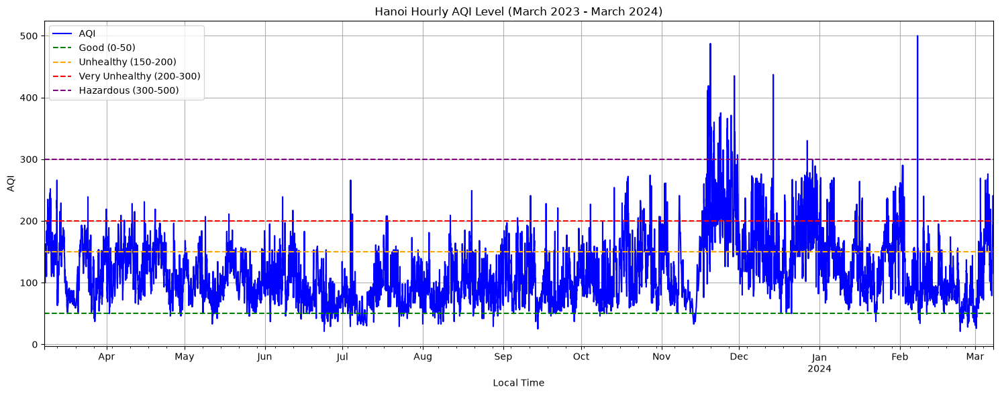
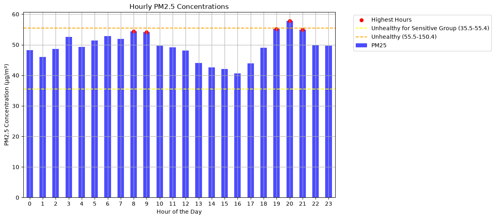
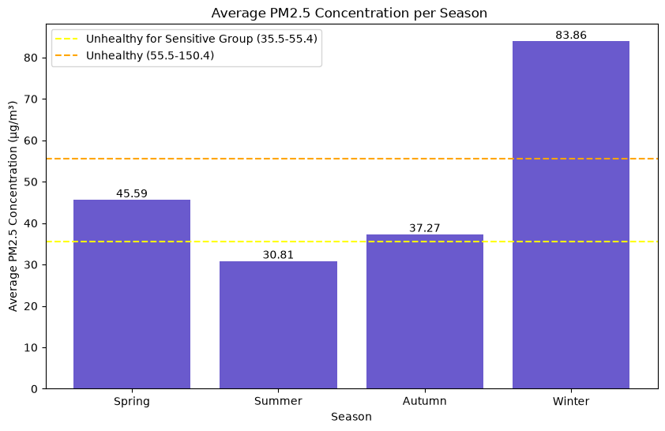
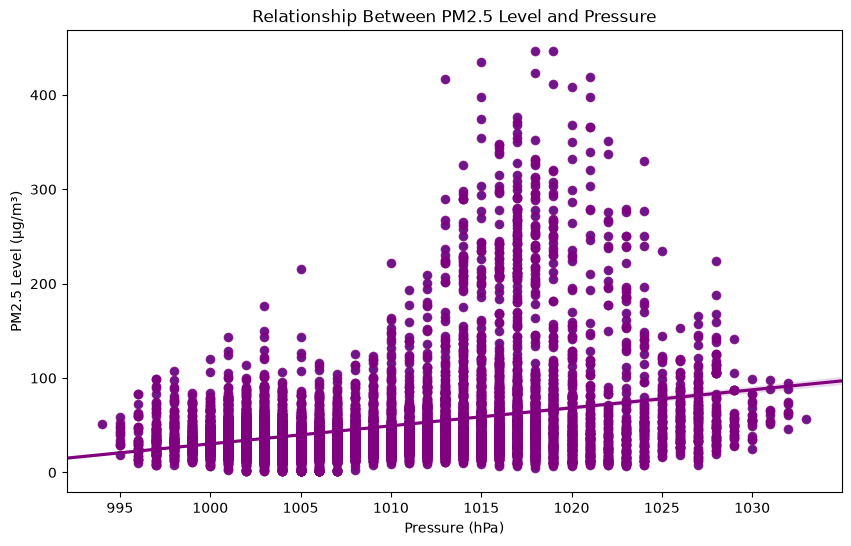
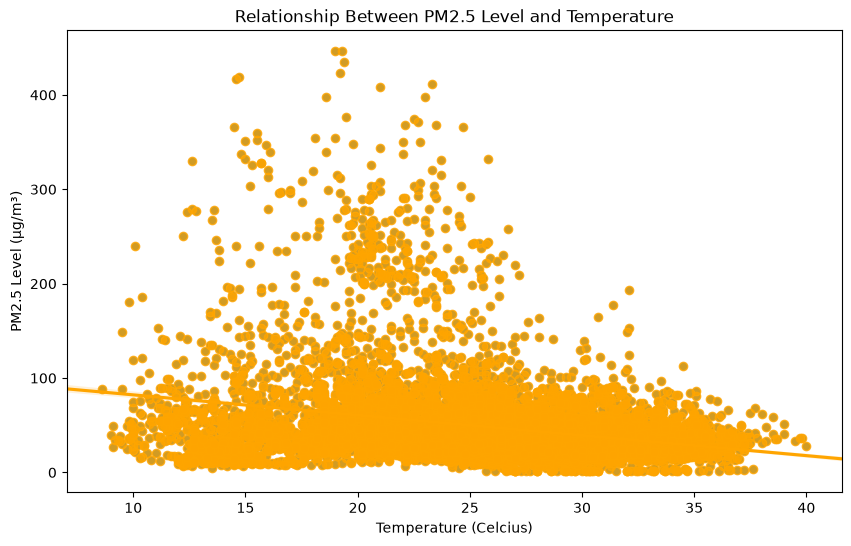
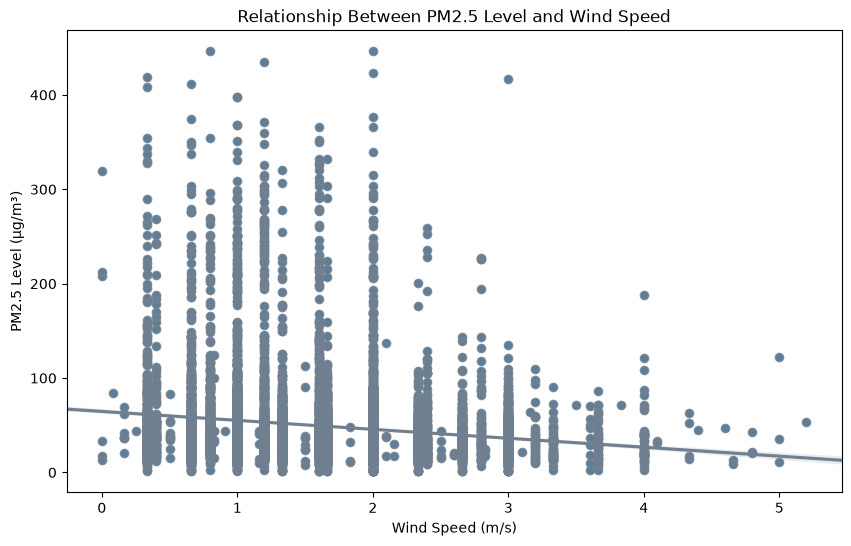
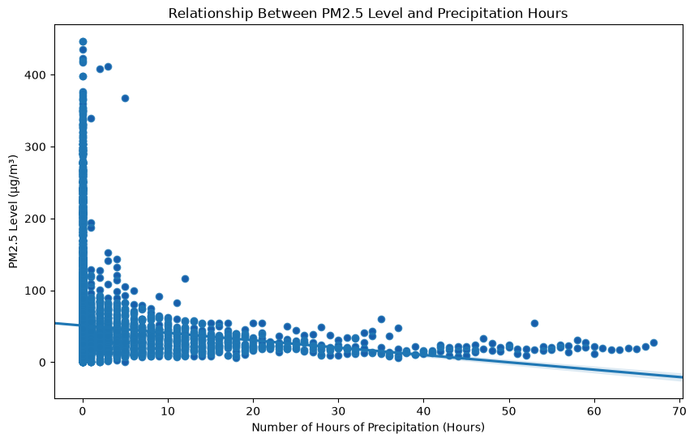
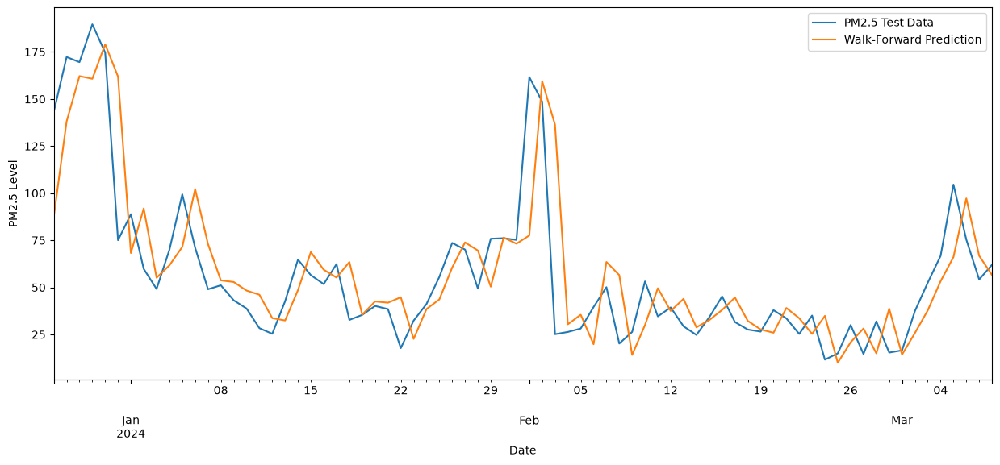

# Phân tích chất lượng không khí Hà Nội theo giờ, mùa và thời tiết

## 1. Giới thiệu

Hà Nội thường xuyên nằm trong nhóm thành phố ô nhiễm không khí nặng nhất Đông Nam Á, đặc biệt vào những tháng cuối năm. Dự án này phân tích dữ liệu **chất lượng không khí (AQI, PM2.5…) và thời tiết theo giờ** của Hà Nội trong một năm (08/03/2023 – 08/03/2024) để trả lời bốn câu hỏi:

1. Trong ngày, **giờ nào** ô nhiễm PM2.5 nặng nhất?
2. **Mùa nào** trong năm có chất lượng không khí tệ nhất?
3. Các yếu tố **thời tiết** (mưa, áp suất, độ ẩm, nhiệt độ, gió) liên quan thế nào tới nồng độ PM2.5?
4. Có thể **dự báo** nồng độ PM2.5 theo ngày bằng mô hình chuỗi thời gian ARIMA không?

PM2.5 được chọn làm biến chính vì đây là thành phần đóng góp nhiều nhất vào AQI (tương quan 0.88 với AQI trong dữ liệu, cùng với PM10) và gây hại cho sức khỏe nhiều nhất.

## 2. Dữ liệu

| | |
|---|---|
| **Nguồn** | [Weatherbit API](https://www.weatherbit.io/): endpoint `history/airquality` (chất lượng không khí) và `history/hourly` (thời tiết) |
| **Phạm vi** | Hà Nội, 00:00 08/03/2023 → 00:00 08/03/2024, theo giờ (giờ địa phương) |
| **Kích thước** | 8 785 dòng × 18 cột, không có giá trị thiếu |
| **File** | [Data/hanoi-aqi-weather-data.csv](Data/hanoi-aqi-weather-data.csv) |

**Các cột chính**

- Chất lượng không khí: `AQI`, `CO` (mg/m³), `NO2`, `O3`, `PM10`, `PM25`, `SO2` (µg/m³)
- Thời tiết: `Clouds` (%), `Precipitation` (mm), `Pressure` (hPa), `Relative Humidity` (%), `Temperature` (°C), `UV Index`, `Wind Speed` (m/s)

**Ngưỡng PM2.5 dùng trong phân tích** (theo US EPA, µg/m³)

| Tốt | Trung bình | Không tốt cho nhóm nhạy cảm | Có hại | Rất có hại | Nguy hại |
|---|---|---|---|---|---|
| 0 – 12 | 12.1 – 35.4 | 35.5 – 55.4 | 55.5 – 150.4 | 150.5 – 250.4 | ≥ 250.5 |

## 3. Cấu trúc dự án

```
├── Part 1 - Extract and Clean Data from API.ipynb             # Thu thập dữ liệu từ API, làm sạch, gộp, xuất CSV
├── Part 2 - Exploratory Data Analysis.ipynb                   # EDA: theo giờ, theo mùa, ảnh hưởng của thời tiết
├── Part 3 - PM2.5 Time Series Analysis with ARIMA Model.ipynb # Dự báo PM2.5 theo ngày bằng ARIMA
├── Data/hanoi-aqi-weather-data.csv                            # Bộ dữ liệu đã làm sạch
├── images/                                                    # Biểu đồ dùng trong README
└── requirements.txt
```

## 4. Cách chạy

```bash
python3 -m venv BDT
source BDT/bin/activate
pip install -r requirements.txt
```

- **Part 2 và Part 3** chạy được ngay với file CSV có sẵn trong `Data/`.
- **Part 1** cần API key Weatherbit có quyền truy cập dữ liệu lịch sử (gói trả phí). Đặt key vào biến môi trường trước khi mở notebook:

  ```bash
  export WEATHERBIT_API_KEY="key_của_bạn"
  ```

  Nếu key không hợp lệ, notebook sẽ dừng ở bước gọi API và in rõ lỗi do Weatherbit trả về (ví dụ HTTP 403).

## 5. Phương pháp

**Part 1 – Thu thập & làm sạch.** Mỗi lần gọi API chỉ lấy tối đa khoảng 30 ngày, nên dữ liệu được lấy thành 12 đợt theo tháng rồi ghép lại. Sau đó loại các dòng trùng ở ranh giới giữa các đợt, chuyển thời gian sang `datetime`, chỉ giữ các biến cần dùng, gộp dữ liệu không khí với thời tiết theo mốc giờ và xuất ra CSV.

**Part 2 – Phân tích khám phá (EDA).**
- Vẽ chuỗi thời gian AQI và PM2.5 theo giờ trong năm.
- Lấy trung bình PM2.5 theo **giờ trong ngày** và theo **mùa**: Xuân (T2–T4), Hạ (T5–T7), Thu (T8–T10), Đông (T11–T1).
- Tạo biến mới *số giờ mưa liên tục* (`Accumulated Hours of Rain`), rồi tính hệ số tương quan Pearson và vẽ biểu đồ phân tán giữa PM2.5 với từng biến thời tiết.

**Part 3 – Dự báo bằng ARIMA.**
- Lấy trung bình PM2.5 theo ngày (367 ngày), chia 80% train (293 ngày) và 20% test (74 ngày).
- Kiểm định tính dừng ADF: tập train không dừng (p = 0.09), nên chọn d = 1.
- Grid search p ∈ [0, 7], q ∈ [0, 2] theo MAE, chọn được **ARIMA(5, 1, 1)**.
- Đánh giá bằng **walk-forward validation**: dự báo 1 ngày tới, sau đó cập nhật mô hình bằng giá trị thật.

## 6. Kết quả chính

### 6.1. Tổng quan

- AQI trung bình **117.6**, thuộc mức *Không tốt cho nhóm nhạy cảm*. PM2.5 trung bình **49.4 µg/m³**, gấp khoảng 10 lần khuyến nghị năm của WHO (5 µg/m³).
- Chỉ **3.6%** số giờ trong năm có AQI ở mức *Tốt* (≤ 50), trong khi **25.7%** số giờ có AQI > 150 (*Có hại* trở lên).
- AQI chạm mức tối đa **500** lúc 19h ngày 07/02/2024. Các đợt *Nguy hại* (> 300) tập trung từ tháng 11 đến giữa tháng 2.



### 6.2. Theo giờ trong ngày

PM2.5 cao nhất vào **8h – 9h sáng** và **19h – 21h tối**, đỉnh là 20h với 57.75 µg/m³. Các khung giờ này trùng giờ cao điểm giao thông. Thấp nhất là khoảng **13h – 16h** (thấp nhất 40.6 µg/m³ lúc 16h), khi nhiệt độ cao và không khí đối lưu mạnh giúp khuếch tán bụi. Tuy vậy, **giờ nào trong ngày cũng vượt ngưỡng 35.5 µg/m³**.



### 6.3. Theo mùa

| Mùa | PM2.5 trung bình (µg/m³) | Mức |
|---|---|---|
| Đông (T11–T1) | **83.86** | Có hại |
| Xuân (T2–T4) | 45.59 | Không tốt cho nhóm nhạy cảm |
| Thu (T8–T10) | 37.27 | Không tốt cho nhóm nhạy cảm |
| Hạ (T5–T7) | 30.81 | Trung bình |

Mùa đông ô nhiễm gần **gấp 3 lần** mùa hạ.



### 6.4. Ảnh hưởng của thời tiết

| Biến thời tiết | Hệ số tương quan với PM2.5 | Nhận xét |
|---|---|---|
| Áp suất | **+0.30** | Áp cao → không khí tù đọng → bụi tích tụ |
| Nhiệt độ | −0.25 | Trời lạnh → nghịch nhiệt giữ bụi sát mặt đất |
| Tốc độ gió | −0.16 | Gió mạnh giúp phát tán bụi |
| Số giờ mưa liên tục | −0.12 | Mưa càng lâu, PM2.5 càng giảm |
| Lượng mưa | −0.09 | Mưa to thường đi kèm PM2.5 thấp |
| Độ ẩm | −0.01 | Gần như không liên quan |

Tất cả các hệ số đều ở mức **yếu đến vừa phải**, tức là không có yếu tố thời tiết đơn lẻ nào giải thích được phần lớn biến động của PM2.5. Ngoài ra, các yếu tố này **gắn chặt với nhau theo mùa**: mùa đông vừa lạnh, vừa áp cao, vừa ít mưa. Vì vậy, các tương quan trên phản ánh một phần hiệu ứng mùa, chưa đủ để kết luận quan hệ nhân quả.

| Áp suất | Nhiệt độ |
|---|---|
|  |  |
| **Tốc độ gió** | **Số giờ mưa liên tục** |
|  |  |

### 6.5. Dự báo PM2.5 bằng ARIMA

| Mô hình | MAE (µg/m³) |
|---|---|
| Baseline (dự đoán bằng trung bình tập train) | 23.13 |
| **ARIMA(5, 1, 1) – walk-forward trên tập test** | **16.95** |



Mô hình bám khá sát xu hướng chung. Tuy nhiên, có thể thấy đường dự báo thường **trễ khoảng 1 ngày** so với các đỉnh ô nhiễm đột ngột (cuối tháng 12, đầu tháng 2), tức là mô hình phản ứng theo đỉnh chứ chưa dự báo trước được đỉnh.

## 7. Hạn chế và hướng phát triển

- **Dữ liệu chỉ có 1 năm và 1 điểm đo cho cả thành phố.** Chưa đủ để kết luận về xu hướng dài hạn hay khác biệt giữa các quận.
- **Tương quan không phải nhân quả.** Nên dùng hồi quy đa biến (có biến mùa) để tách riêng ảnh hưởng của từng yếu tố thời tiết.
- **Đánh giá ARIMA chưa thật chặt chẽ.** MAE baseline được tính trên tập train, còn MAE của ARIMA tính trên tập test. Nên so thêm với baseline "ngày mai bằng hôm nay" (persistence) trên cùng tập test.
- **Hướng mở rộng:** dùng SARIMAX với biến thời tiết làm biến ngoại sinh, hoặc thử các mô hình học máy như XGBoost, LSTM. Cũng có thể thu thập thêm nhiều năm dữ liệu từ nguồn miễn phí như Open-Meteo Air Quality API.

## 8. Khuyến nghị cho người dân

Những ngày PM2.5 ở mức có hại, đặc biệt vào mùa đông và các khung giờ cao điểm 8h – 9h, 19h – 21h:

- Hạn chế ra ngoài và tập thể dục ngoài trời. Nếu phải ra ngoài, nên đeo khẩu trang N95 hoặc loại tương đương.
- Đóng cửa sổ và dùng máy lọc không khí có màng lọc HEPA.
- Theo dõi AQI hằng ngày (IQAir, PAM Air…) để chủ động lên kế hoạch.

## 9. Tài liệu tham khảo

- Dự án được phát triển dựa trên [Hanoi-Air-Quality-Analysis](https://github.com/namanhnt/Hanoi-Air-Quality-Analysis) của Nam Aaron Nguyen. Các thay đổi gồm: Việt hóa toàn bộ notebook, xử lý lỗi API, sửa lỗi trong code và bổ sung phần đánh giá, hạn chế.
- [Weatherbit API](https://www.weatherbit.io/) – nguồn dữ liệu
- [US EPA – Air Quality Index](https://www.epa.gov/outdoor-air-quality-data/air-data-basic-information)
- [IQAir – 2019 World Air Quality Report](https://www.iqair.com/world-most-polluted-cities/world-air-quality-report-2019-en.pdf)
- [UCAR – How Weather Affects Air Quality](https://scied.ucar.edu/learning-zone/air-quality/how-weather-affects-air-quality)
- [VnExpress – Hanoi's air quality dropping over large scales](https://e.vnexpress.net/news/environment/hanoi-s-air-quality-dropping-over-large-scales-4719205.html)
